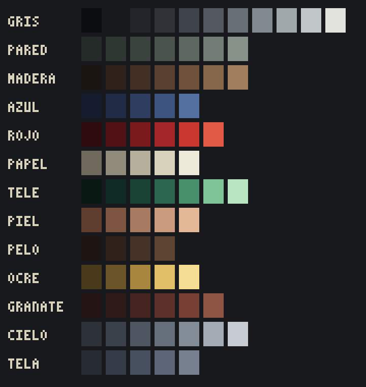
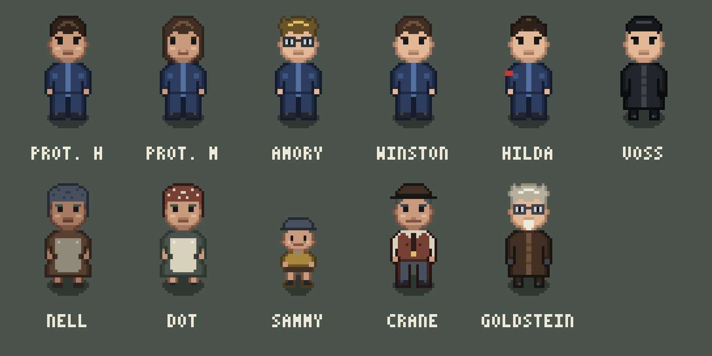

# CAPÍTULO II — Biblia visual (v0.1)

> Dirección de arte, paleta, reglas de construcción, personajes, retratos, escenarios e interfaz.
> Todo el arte se genera por código con la librería [art/lib/pixel.py](../art/lib/pixel.py).
> Referencias: [guion.md](guion.md) · [diseno-tecnico.md](diseno-tecnico.md)

| Referencia | Imagen |
|---|---|
| Escena de prueba (piso del protagonista) | [art/pruebas/piso_hd@3x.png](../art/pruebas/piso_hd@3x.png) |
| Protagonista en 4 direcciones | [art/personajes/protagonista_hoja@6x.png](../art/personajes/protagonista_hoja@6x.png) |
| Elenco principal | [art/personajes/elenco@5x.png](../art/personajes/elenco@5x.png) |
| Paleta | [art/paleta@4x.png](../art/paleta@4x.png) |
| Retratos del crimen facial | [art/personajes/retratos_protagonista@2x.png](../art/personajes/retratos_protagonista@2x.png) |

---

## 1. Dirección de arte

### 1.1 La idea

**Un juego bonito sobre un mundo feo.** El estilo es el de los RPG de pixel art que el jugador asocia a lo acogedor (Stardew Valley, Pokémon, Final Fantasy VI): vista cenital 3/4, personajes cabezones, madera cálida y objetos con mimo. Ese confort visual es una trampa deliberada. El jugador debe sentirse "en casa" en el piso del protagonista igual que el protagonista se siente en casa en el Partido. La crudeza llega por contraste.

### 1.2 Los cuatro mundos

Cada tipo de lugar tiene una identidad cromática clara, que el jugador aprende sin que nadie se la explique:

| Mundo | Lugares | Rampas dominantes | Sensación |
|---|---|---|---|
| **El Partido** | Mansiones Victoria, calles del centro, Minipax, Miniver, Centro de la Comunidad | `gris`, `pared`, `azul`, `tele`, acentos de `rojo` | Orden, humedad, vigilancia. El verde de la telepantalla es la única luz "viva". |
| **Los proles** | Limehouse, mercado, La Campana, estudio de Crane, casa de Dot | `madera`, `ocre`, `granate`, `papel`, `tela` | Desorden cálido, ropa tendida, faroles de gas. Más saturación y más variedad de color que en ningún otro sitio. |
| **El Minimor** | Recepción, pasillos, celda, sala de O'Brien, Habitación 101 | `gris` alto, `papel` pálido. **Nada más.** | Blanco quirúrgico, sin sombras, sin rojo, sin verde. La luz no parpadea nunca. |
| **La memoria** | Cripta de San Clemente, sueños, flashbacks de Ivy, epílogo del Final D | `ocre`, `madera` clara, `papel` | Ámbar de vela. Es la paleta más cálida del juego y solo aparece donde se recuerda de verdad. |

### 1.3 La Duda en la imagen

El shader de paleta (ver [diseño técnico §3.2](diseno-tecnico.md)) desplaza la imagen entre la paleta del Partido y la de la memoria según la Duda y el lugar. **Regla para el arte:** cada escena se pinta en su versión "neutra" (la de esta biblia). El shader solo la enfría o la calienta. No se dibujan versiones alternativas por Duda, salvo objetos concretos que el guion exige que cambien (el cartel de Ivy torcido o arrancado, la foto restaurada…).

---

## 2. Especificaciones técnicas

| Elemento | Medida |
|---|---|
| Resolución del arte | **480 × 270** (30 × 17 tiles) |
| Tile | **16 × 16** |
| Personaje adulto | **20 × 40** (cabeza de 18 filas, cuerpo de 22) |
| Personaje niño | **16 × 27** |
| Retrato de diálogo | **64 × 64** (se muestra al doble en la UI de 960×540) |
| Retrato de crimen facial | **96 × 96** (solo el protagonista; ver §6) |
| Pared del fondo en interiores | **4 tiles de alto** (64 px), incluidos friso y zócalo |
| Grosor de muro visto desde arriba | **12 px** |
| Iconos de inventario | **16 × 16** |
| Fuente de rótulos dentro del mundo | 3×5 px (carteles, pantallas, documentos lejanos) |

---

## 3. Paleta



La paleta se organiza en **13 rampas de material**, de oscuro a claro. La fuente de verdad es `RAMPS` en [art/lib/pixel.py](../art/lib/pixel.py).

| Rampa | Tonos | Uso principal |
|---|---|---|
| `gris` | 11 | Metal, hormigón, ropa del Partido Interior, Minimor, contornos neutros |
| `pared` | 7 | Papel pintado y yeso verdoso de los edificios del Partido |
| `madera` | 7 | Suelos, muebles, marcos, el chaleco y el sombrero de Crane |
| `azul` | 5 | **Mono del Partido Exterior** (protagonista, Amory, Winston, Hilda…) |
| `rojo` | 6 | Propaganda: carteles, banderas, brazaletes, el piloto de la telepantalla |
| `papel` | 5 | Papel, sábanas, delantales, documentos, la pirámide de los ministerios |
| `tele` | 7 | Telepantallas y su resplandor. **Reservado**: no se usa para otra cosa. |
| `piel` | 5 | Piel (se desplaza un tono arriba o abajo para variar personajes) |
| `pelo` | 4 | Pelo castaño oscuro y negro |
| `ocre` | 5 | Luz de vela, farolas de gas, metal dorado, pelo rubio |
| `granate` | 6 | Alfombras, telas proles, ropa cálida |
| `cielo` | 7 | Cielo y siluetas urbanas a través de ventanas, cristal de gafas |
| `tela` | 5 | Abrigos de lana, cortinas, pañuelos, gorras |

### 3.1 Reglas de color

1. **Ningún color fuera de las rampas.** La única excepción son los resplandores, que se mezclan por código con el color de la luz y el del material.
2. **Entre 2 y 4 tonos por material** en un mismo objeto: sombra, base, luz y, a veces, brillo.
3. **Contorno selectivo:** cada objeto se perfila con el tono más oscuro **de su propia rampa**, no con negro. El negro puro (`gris 0`) se reserva para el vacío, el fuera de campo y la ropa de Voss.
4. **El rojo es un acento.** Nunca más de un ~8 % de la pantalla, salvo en la Semana del Odio y en el cartel de Ivy en primer plano.
5. **El verde `tele` es exclusivo de las telepantallas.** Si algo es verde, el jugador debe pensar inmediatamente que le están mirando.
6. **El blanco del Minimor** usa `gris 9–10` y `papel 4`, sin sombras proyectadas.

---

## 4. Construcción de escenarios

### 4.1 Perspectiva cenital 3/4

- **Las paredes del fondo se ven de frente** (4 tiles de alto) y **los suelos desde arriba**.
- **Los muebles muestran su cara superior y su cara frontal.** La cara superior lleva el tono más claro y la frontal un tono menos.
- **Los muros laterales e inferiores** se ven solo como **tapas de 12 px** desde arriba, en `gris 3` con un filo de `gris 4`.
- Los objetos colgados (cuadros, cartel, telepantalla, estantes) van en la pared del fondo. **Proyectan una sombra de 2 px hacia abajo y a la derecha.**
- **Los objetos con altura** (armario, cama, perchero, personas) proyectan una sombra en el suelo: un rectángulo o elipse con el tono −1 o −2 de la rampa del suelo, desplazado unos +3 px a la derecha y abajo.

### 4.2 Luz

| Tipo | Cómo se hace | Ejemplo |
|---|---|---|
| **Haz de ventana** | Polígono en diagonal sobre el suelo: +1 paso en los bordes y +2 en el centro. | Piso del protagonista |
| **Resplandor de telepantalla** | 3 anillos de mezcla con `tele 4` (26 %, 15 % y 7 %), aplastados en vertical. Solo dentro de la habitación. | Todas las telepantallas |
| **Oclusión en bordes** | −1 paso en los 5 px del suelo junto a cada muro. | Todos los interiores |
| **Farol de gas** | Igual que el resplandor, pero con `ocre 3`. | Limehouse de noche |
| **Vela** | Resplandor `ocre 4` pequeño e intenso, más −1 en el resto de la escena. | Cripta, sótano de La Campana |
| **Minimor** | Ninguna. Luz plana. Es la ausencia de luz dramática lo que inquieta. | Minimor |

La luz **sube o baja pasos dentro de la rampa de cada material** (`Canvas.add_light`, `bake_lighting`), así que la madera nunca se vuelve roja ni la pared se vuelve gris.

### 4.3 Atrezo narrativo

Cada escenario debe tener al menos **un detalle que cuente algo sin texto**: humedad en la pared del piso, una ratonera, el periódico en la cama, la maceta seca, la maleta sobre el armario que nunca se usa. El jugador atento debe sentir que el lugar existía antes de que él llegara.

---

## 5. Personajes

### 5.1 Construcción

- **Generador modular** ([art/personajes/elenco.py](../art/personajes/elenco.py)): cada personaje = **cabeza** (18 filas) + **cuerpo** (22 filas) + **parches** (gafas, brazalete, perilla, sonrisa…) + **paleta**.
- Las vistas frontal y trasera se definen **por mitades de 10 columnas reflejadas**. La vista lateral se dibuja completa y la izquierda es el reflejo de la derecha.
- **Piezas disponibles:**
  - Cabezas: `corto`, `melena`, `despeinado`, `repeinado`, `moño`, `pañuelo`, `sombrero`.
  - Cuerpos: `mono`, `abrigo`, `vestido`, `chaleco`.
  - Plantilla `niño`.
- **Proporciones:** cabeza grande (45 % de la altura), al estilo RPG. Los ojos son de 2×1 o 2×2 píxeles. **Las expresiones no se hacen en el sprite, sino en los retratos.**

### 5.2 Animaciones

| Animación | Fotogramas | Direcciones | Quién |
|---|---|---|---|
| Quieto (respiración leve) | 2 | 4 | Todos |
| Caminar | 4 | 4 | Todos los que se mueven |
| Correr | 4 | 4 | Protagonista |
| Agacharse / recoger | 2 | 2 | Protagonista |
| Escribir en el diario | 3 | 1 (de espaldas, en el ángulo muerto) | Protagonista |
| Gimnasia | 4 | 1 | Protagonista |
| Gritar en el Odio (puño en alto) | 2 | 1 | Protagonista y multitud |
| Esconderse | 2 | 1 | Protagonista |
| Caer / ser golpeado | 3 | 1 | Protagonista |
| Limpiar (barrer, vaciar papelera) | 4 | 2 | Nell |
| Teclear | 2 | 1 (de espaldas) | Funcionarios del Minipax y del Miniver |

### 5.3 Elenco



| Personaje | Pieza de cabeza | Cuerpo | Paleta | Rasgo de silueta (lo que se lee a distancia) |
|---|---|---|---|---|
| **Protagonista (H)** | `corto` | `mono` | `pelo` · `azul` | El mono azul más limpio de la oficina. |
| **Protagonista (M)** | `melena` | `mono` | `madera` (pelo castaño) · `azul` | Melena hasta los hombros. |
| **Felix Amory** | `despeinado` + gafas | `mono` | `ocre` (rubio) · `azul` | Pelo de punta y gafas redondas: la única cabeza clara de la oficina. |
| **Winston Smith** | `corto` | `mono` | `madera` · `azul`, piel pálida | Corriente a propósito. Se distingue por su animación encorvada y la tos. |
| **Hilda Grubb** | `moño` | `mono` + brazalete | `pelo` · `azul` · `rojo` | Moño tirante y brazalete rojo del Comité. |
| **Subdirector Voss** | `repeinado` | `abrigo` | `gris` (negro) + guantes negros | Abrigo negro largo en interiores. Es la única figura negra del Minipax. |
| **Nell Hask** | `pañuelo` | `vestido` + delantal | `tela` · `madera` · `papel` | Pañuelo gris y carrito de limpieza. Encorvada, siempre con la cabeza baja (hasta J3.05). |
| **Dot Pike** | `pañuelo` (estampado) | `vestido` + delantal | `granate` · `pared` · `papel` | Pañuelo rojo con lunares, brazos fuertes. Es el color más vivo de Limehouse. |
| **Sammy** | plantilla `niño` (gorra) | — | `tela` · `ocre` | Pequeño, gorra y colgante de metralla (1 px de `gris 7`). |
| **Abel Crane** | `sombrero` + sonrisa | `chaleco` | `madera` · `granate` · `papel` | Sombrero, chaleco de lana y corbata: el único "señor" del barrio. Siempre sonríe. |
| **Emmanuel Goldstein** | `despeinado` (blanco) + gafas + perilla | `abrigo` | `papel` · `madera` | Perilla blanca y gafas: es la cara de los Dos Minutos de Odio, pero pequeño y con manta. |
| *Pendientes* | | | | Brooke, Pell, Parsons (cuerpo `mono` ancho) y sus hijos (`niño` con pañuelo de los Espías), Julia (faja escarlata), O'Brien (abrigo negro y gafas, corpulento), Syme, Barlow, Len, guardias y Policía del Pensamiento, funcionarios genéricos, multitud y proles genéricos. |

### 5.4 Personajes genéricos

Para multitudes, oficinas y calles se combinan piezas y paletas al azar con estas restricciones:

| Grupo | Cabezas | Cuerpo | Paleta |
|---|---|---|---|
| Funcionarios del Partido Exterior | `corto`, `melena`, `moño`, `repeinado` | `mono` | `azul` (variando el tono de piel y de pelo) |
| Partido Interior | `repeinado`, `corto` | `abrigo` | `gris` oscuro |
| Guardias y Policía del Pensamiento | `corto` + gorra (pieza pendiente) | `abrigo` | `gris` 0–2 |
| Proles | `pañuelo`, `despeinado`, `sombrero` | `vestido`, `chaleco` | `madera`, `granate`, `tela`, `ocre` |
| Espías (niños) | `niño` + pañuelo rojo | — | `azul` · `rojo` |

---

## 6. Retratos

### 6.1 Retratos de diálogo (64×64)

- **Busto de tres cuartos** que mira hacia el centro de la pantalla. Aparece a la izquierda de la caja de diálogo.
- Más detalle que el sprite: 3–4 tonos de piel, pelo con mechones y ropa con pliegues.
- **Fondo:** un tono plano de la paleta del mundo del personaje (verde grisáceo para el Partido, ocre para los proles, blanco para el Minimor).
- **Expresiones por personaje (mínimo):** neutral, contento, preocupado y enfadado. Los personajes principales tienen variantes del guion:
  - Amory: "entusiasta" y "confesión" (sin dientes ni gafas).
  - Nell: "mirada dura" (J3.05) y "media sonrisa" (J7).
  - Crane: "sonrisa" y "sin sonrisa" (J12).
  - Dot: "llanto en silencio" (J5).
  - Goldstein: "risa y tos".
- El **Gran Hermano** no tiene retrato: solo existe en carteles y pantallas.

### 6.2 Retrato del protagonista para el crimen facial (96×96)

Es el retrato más importante del juego, porque es la interfaz del microjuego (ver [diseño técnico §6.2](diseno-tecnico.md)).

| Expresión | Notas |
|---|---|
| Neutral | Base |
| Entusiasmo | Cejas arriba, sonrisa amplia (gimnasia) |
| Odio | Cejas juntas, dientes, venas en el cuello (Dos Minutos de Odio) |
| Júbilo | Ojos cerrados, boca abierta (noticias de victoria, ejecuciones) |
| Desprecio | Labio torcido, mirada de lado (confesión de Amory) |
| Duelo patriótico | Mirada hacia arriba, ojos húmedos (Gran Hermano, mártires) |
| **Máscara agrietada** | Variante de cada expresión con la cara "rajada" en pixel art cuando se falla: grietas de `gris 1` sobre la piel. |

Las dos versiones (H y M) comparten la composición; solo cambian el pelo y los rasgos.

> **Estado:** prueba hecha → [art/personajes/retratos_protagonista@2x.png](../art/personajes/retratos_protagonista@2x.png) (generador: [retrato_protagonista.py](../art/personajes/retrato_protagonista.py)). La cara se construye por capas y cada expresión es un conjunto de parámetros de ojos, cejas y boca. Lleva un **contraluz verde por la derecha** (la telepantalla siempre está ahí).

---

## 7. Escenarios

### 7.1 Tilesets (piezas reutilizables)

| Tileset | Contenido | Escenarios que lo usan |
|---|---|---|
| **Vivienda del Partido** | Papel pintado verdoso, friso, tablones, muebles baratos, telepantalla doméstica | Piso del protagonista, escalera y rellanos de las Mansiones Victoria, puerta de los Parsons, Centro de la Comunidad |
| **Oficina ministerial** | Mármol pálido, linóleo, mesas con máquina de escribir, tubos neumáticos, agujero de la memoria, archivadores, telepantalla de oficina | Minipax (todas sus salas), Miniver, despacho del Partido Interior (variante con alfombra) |
| **Minimor** | Azulejo blanco, acero, puertas numeradas, banco de celda | Recepción, pasillos, Archivo B, celda, sala de O'Brien, Habitación 101 |
| **Calle del centro** | Adoquín, fachadas grises, carteles, farolas eléctricas, coches del Partido | Avenida de la Victoria, plaza, parque, exterior de los ministerios |
| **Barrio prole** | Ladrillo ennegrecido, ropa tendida, charcos, farolas de gas, puestos de mercado, escombros | Limehouse (calles, mercado, casa alcanzada), exterior de La Campana, calle Cable |
| **Interior prole** | Madera vieja, papel pintado de flores despegado, estufa, cocina | La Campana (y su sótano), estudio de Crane, casa de Dot, Café del Castaño (variante) |
| **Subterráneo** | Raíles, agua, ladrillo de túnel, nichos, carteles antiguos, andenes | Metro (los cinco tramos), taller de telepantallas |
| **Cripta** | Piedra, lápidas, velas, estanterías con libros, campanario vacío | San Clemente |

### 7.2 Lista de escenarios

Prioridad: **M1** = corte vertical (Prólogo + J1). **A1–A4** = acto en que aparecen por primera vez.

| # | Escenario | Tileset | Prioridad | Notas |
|---|---|---|---|---|
| 1 | Calle Stepney en ruinas (noche, 1979) | Barrio prole + escombros | **M1** | Fuego, telepantalla rota en el suelo |
| 2 | Piso del protagonista | Vivienda | **M1** | ✅ Prueba hecha |
| 3 | Escalera y rellanos de las Mansiones Victoria | Vivienda | **M1** | 2 rellanos y la puerta de los Parsons |
| 4 | Avenida de la Victoria | Calle del centro | **M1** | Desplazamiento horizontal; helicóptero |
| 5 | Vestíbulo del Minipax | Oficina | **M1** | Torniquetes y guardias |
| 6 | Dpto. de Partes y Cartografía | Oficina | **M1** | Mapa de Malabar, mesas y mesa del Registro |
| 7 | Cantina del Minipax | Oficina | **M1** | |
| 8 | Despacho de Voss | Oficina | A1 | Única ventana de la planta |
| 9 | Gran Salón del Miniver | Oficina | A1 | Telepantalla gigante, hileras de sillas |
| 10 | Centro de la Comunidad | Vivienda | A1 | Ping-pong, pancartas, piano |
| 11 | Sueño (calle sepia) | Barrio prole (filtro sepia) | A1 | |
| 12 | Pasillo y cuarto de suministros del Minipax | Oficina | A1 | Hueco de la telepantalla retirada |
| 13 | Limehouse: calles | Barrio prole | A2 | |
| 14 | Limehouse: casa alcanzada | Barrio prole | A2 | Casa partida "de muñecas" |
| 15 | Pub La Campana | Interior prole | A2 | La campana de "S. Clem…" |
| 16 | Mercado de Watney Street (+ versión destruida) | Barrio prole | A2 | |
| 17 | Estudio Crane | Interior prole | A2 | Cuarto oscuro con bombilla roja |
| 18 | Archivo del departamento | Oficina | A2 | |
| 19 | Sala de calderas y montacargas | Subterráneo (variante) | A3 | |
| 20 | Planta 11 y Archivo Restringido | Oficina | A3 | Bombilla verde, carpetas azules |
| 21 | Sótano de La Campana | Interior prole | A3 | Vela; ladrillo suelto |
| 22 | Departamento de Registro del Miniver | Oficina | A3 | Cubículos de cristal |
| 23 | Cantina del Miniver | Oficina | A3 | |
| 24 | Lavabos de la planta 3 | Oficina (azulejo) | A3 | Vaho en el espejo |
| 25 | Banco del parque | Calle del centro | A3 | |
| 26 | Plaza de la Victoria (mitin) | Calle del centro | A3 | Multitud, tribuna, efigies |
| 27 | Parque de la Victoria (patíbulo) | Calle del centro | A3 | |
| 28 | Minimor: exterior y recepción | Minimor | A3 | |
| 29 | Minimor: pasillos y Archivo B | Minimor | A3 | |
| 30 | Casa de Dot (cocina y despensa) | Interior prole | A3 | Colección de metralla en la repisa |
| 31 | Boca de metro de Shadwell | Barrio prole | A4 | |
| 32 | Túneles (5 tramos) | Subterráneo | A4 | Linterna, nichos, agua |
| 33 | Taller de telepantallas y andén de los nombres | Subterráneo | A4 | Nombres en tiza |
| 34 | Cripta de San Clemente | Cripta | A4 | La escena más cálida del juego |
| 35 | Celda del Minimor | Minimor | Finales | |
| 36 | Sala de O'Brien | Minimor | Finales | Camilla, dial |
| 37 | Habitación 101 | Minimor | Finales | Techo bajo, tolva de escombros |
| 38 | Café del Castaño | Interior prole (variante gris) | Finales | |
| 39 | Despacho del Partido Interior | Oficina (variante de lujo) | Final E | Ventana real, café de verdad |
| 40 | Estudio fotográfico de Southwark | Interior prole (recoloreado) | Final B | Reutiliza el estudio Crane |
| 41 | Patio prole (epílogo) | Barrio prole (luz de mañana) | Final D | La paleta más luminosa del juego |

---

## 8. Interfaz

| Elemento | Estilo |
|---|---|
| **Caja de diálogo** | Papel `papel 3` con borde `gris 2` y una franja roja a la izquierda (el "sello" del Partido). El retrato va encima de la esquina izquierda. |
| **Pensamiento** | Sin caja: texto en `papel 4` en cursiva con sombra de 1 px, arriba de la pantalla. Con la Duda alta pasa a `ocre 4`. |
| **Telepantalla** | Texto `tele 5` sobre `tele 0` con líneas de barrido. |
| **Documentos del Partido** | Papel `papel 3–4`, fuente de máquina de escribir, sellos `rojo 3`, membrete con la pirámide del ministerio. |
| **Diario** | Papel crema (`papel 4`) con líneas `cielo 5`, letra "a lápiz" en `gris 3` y el pájaro de Amory dibujado en la tapa. |
| **Ficha de Afiliación** | Papel amarillento (`papel 2`) con casillas mecanografiadas y sello rojo **APTO**. |
| **Indicador de Sospecha** | Un ojo de 16×16 en la esquina: cerrado, entreabierto, abierto, abierto con venas (`rojo`). |
| **Inventario** | Tira de casillas de 20×20 con fondo de madera oscura. |
| **Menú principal** | El cartel de Ivy a pantalla completa, con el título *CAPÍTULO II* mecanografiado encima. Los desbloqueos de los finales aparecen como frases a lápiz en el margen. |

---

## 9. Proceso de producción

1. **Todo el arte es código** en `art/`, con los PNG generados al lado. Los PNG finales se exportan a `assets/` en el formato que espera Phaser (hojas de sprites y tilesets).
2. **Cada pieza nueva** pasa por: dibujo → render con previsualización ampliada → revisión → ajuste → aprobación.
3. **Orden de producción:**
   1. Retrato de crimen facial del protagonista (prueba de estilo).
   2. Tileset de vivienda.
   3. Tileset de oficina.
   4. Escenarios M1 (6 restantes).
   5. Animaciones de caminar del protagonista.
   6. Personajes de M1 (Winston, Hilda, Amory, Voss, Nell y genéricos).
   7. Resto por actos.
4. **Estructura de carpetas:**
   ```
   art/
   ├── lib/          ← pixel.py (paleta, primitivas, luz, fuente)
   ├── personajes/   ← protagonista.py, elenco.py, retratos/
   ├── tilesets/     ← vivienda.py, oficina.py, …
   ├── escenarios/   ← un script por escenario
   ├── ui/
   ├── pruebas/
   └── paleta.py
   ```

---

## 10. Pendientes de validar

1. ~~Prueba de estilo de los retratos~~ → hecha, pendiente de aprobación.
2. **Animación de caminar** del protagonista (4 direcciones × 4 fotogramas).
3. **Piezas que faltan:** gorra de guardia, cuerpo ancho (Parsons), faja de la Liga Anti-Sex (Julia) y el físico corpulento de O'Brien.
